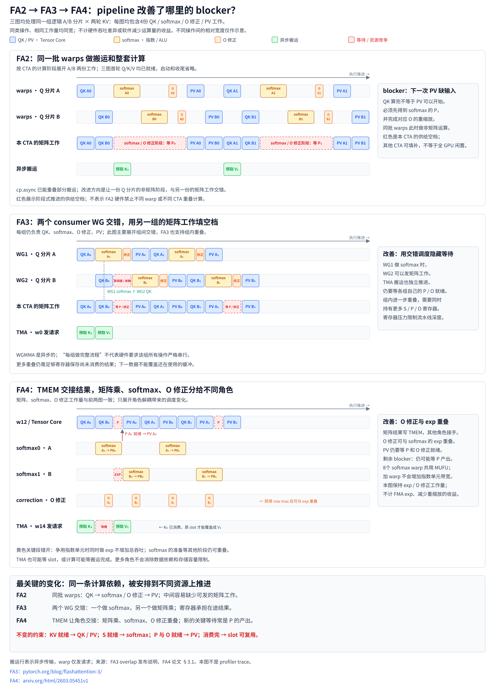

# FA2 / FA3 / FA4 pipeline 的 blocker

## 一句话目的

用同一工作量、同一宽度，比较 FA2、FA3、FA4 的 pipeline 中哪里被阻塞，以及后续设计如何缓解这些阻塞。

## 核心知识点

- **比较方式**：三张图处理相同的逻辑工作量（A / B 两个 Q 行分片，连续两轮 KV，每轮都有 QK、softmax、O 修正和 PV）。横向长度只用于说明重叠与依赖，是示意权重，不是 FLOPs、指令数或周期，**不能用来计算加速倍数**。
- **不会消失的 blocker**：
  - KV 数据就绪，才能执行对应的 QK / PV。
  - S 就绪，softmax 才能开始；P 与 O 状态就绪，PV 才能开始。
  - 多个 softmax warp 共用 SM 的指数资源，增加 warp 不等于增加指数单元吞吐。
  - 拿到新的 row max / 重缩放系数后，独立的 correction 可以与 exp 重叠；O 修正没有消失，只是换了执行角色和时机。
  - 缓冲数据被消费并确认释放后，slot 才能被覆盖。FA4 的 3 个 K-or-V slot 可以同时放当前 K、当前 V 和下一个 K。
  - 寄存器、SMEM / TMEM 容量、带宽和资源竞争仍会限制可以重叠的程度。
- **图是机制示意**：不是精确的源码 timeline 或 profiler trace。FA2 的 CTA 分阶段推进是抽象排布，不能据此推断硬件禁止 warp 间或 CTA 间重叠。

## 来源

- [完整上下文（SVG、生成器与 renderer）](../../sources/fa-pipeline-context.md)
