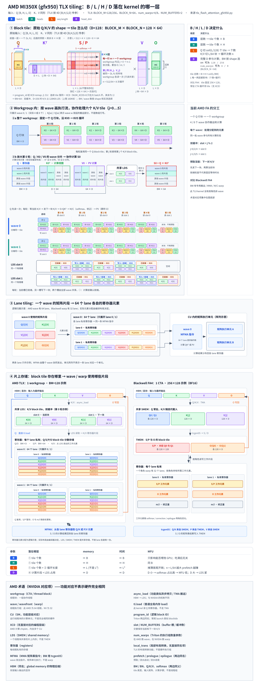

# AMD MI350X（gfx950）TLX FlashAttention tiling

## 一句话目的

说明 B / L / H / D 分别落在 kernel 的哪一层：每个 workgroup 负责一个 Q 行块，wave 和 lane 再分片处理。

## 核心知识点

- **配置**：MI350X / gfx950 上的 TLX FlashAttention forward kernel，BLOCK_N = 64，num_warps 为 4 或 8（即 256 或 512 个线程），NUM_BUFFERS = 2。
- **四层关系**：workgroup（CTA）的 block tile → wave（64 线程）使用的片段 → lane 私有寄存器中的元素。LDS 对应 NVIDIA 的 SMEM，MFMA 是矩阵乘加指令。
- **block tile**：固定 (batch, head) 后，一个 workgroup 固定一个 Q 行块（BM × D），循环处理全部 K/V block；不在内存里构造完整的 L × L 的 S / P。
- **存储路径**：Q 从 HBM 经 tl.load 进寄存器，循环中复用，不先放 LDS；K / V 经 async_load 进 LDS，再读到寄存器，最后进入 MFMA；MFMA 的操作数来自寄存器，不直接读 LDS。
- **双缓冲**：prologue 把 K0 / V0 发到 slot 0；稳态中依次等待当前 KV、把 KV 从 LDS 读入寄存器、发起下一块的搬运、做 QK、softmax 和在线修正，再做 PV。两个 slot 由整个 workgroup 共享。
- **分工**：同一批 wave 既搬运、又做矩阵乘和 softmax，并没有 FA4 那样的专职角色。

## 注意

- “64”是一个 wave 的线程数，不是 wave 的数量。
- lane 级的图是逻辑示意，没有经过编译产物验证，不要解读为精确的 MFMA 片段布局。

## 来源

- [完整上下文（SVG 源码与 renderer）](../../sources/amd-tiling-mi350x-context.md)
