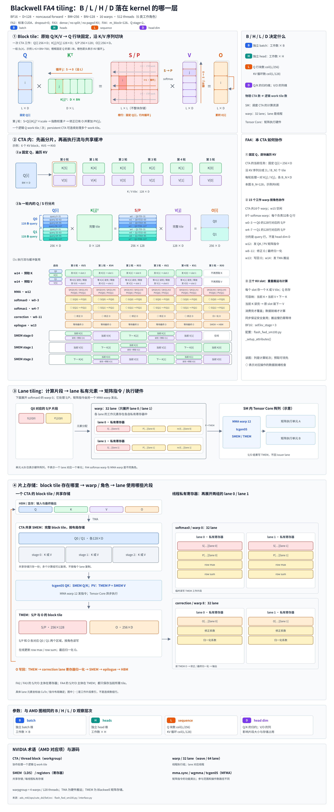

# Blackwell FA4 tiling（tcgen05 与 TMEM 路径）

## 一句话目的

展示 FA4 在 Blackwell 上的分块：一个逻辑 Q 任务拆成 Q0 / Q1 两块，16 个 warp 的角色分工，以及 S / P / O 主要驻留在 TMEM 的数据流。

## 核心知识点

- 配置：BF16，D = 128，noncausal forward；m_block = 128，q_stage = 2，所以逻辑 B_M = 256；B_N = 128。256 是当前 Q 任务的 query 数，不是 D 变成 256。
- 示例 L = 6 × 128 = 768，Q 有 3 个 256 行的块。每个逻辑 Q 任务拆成 Q0 / Q1，各 128 × D，两块都和同一个 K[j] / V[j] 配合。
- 16 个分配的 warp（512 线程）：w0–3 为 softmax0，w4–7 为 softmax1，w8–11 为 correction，w12 为 MMA，w13 为 epilogue，w14 为 load，w15 为空。“六类角色”是软件角色，不是六个硬件 warpgroup。
- softmax0 处理 Q0 对应的 128 行 S，softmax1 处理 Q1 的 128 行，每组 4 个 warp，每个 warp 处理 32 行；每个 lane 对应一行 S，维护 row max 和 row sum。
- correction 组修正 O 并做最终归一化；epilogue 组把结果从 SMEM 写回 HBM。输出路径是 TMEM → correction 的 lane 寄存器 → SMEM staging → HBM。
- Q / K / V 都在 SMEM 中。tcgen05 的 QK 从 SMEM 取 Q 和 K，PV 取 TMEM 中的 P 和 SMEM 中的 V。
- K 和 V 共用同一组 SMEM 物理区域，BF16 配置为 3 个 KV stage，**每个 stage 只放一个 K 或一个 V**，不是三对 KV。`kv_stage` 在 dtype 宽度小于等于 8 时为 4，此 BF16 配置为 3。
- load warp 的请求顺序：Q0 → K[5] → Q1 → V[5]，然后 K[4]、V[4] 交替推进；能多早发出取决于 stage 是否空闲以及 barrier。

## 注意

- FA3 的两个 consumer WG 各自做完整的 QK / softmax / PV；FA4 的两个 softmax 组只负责各自 S 行的 softmax，矩阵由 w12 发起、O 由 correction 修正。两者的分工不同。
- 不能仅凭 warp 数、Q 块数或 stage 数判断哪个实现更快。这份上下文不包含跨 GPU 的性能结论。

## 来源

- [完整上下文（SVG、生成器与 renderer）](../../sources/blackwell-fa4-tiling-context.md)
