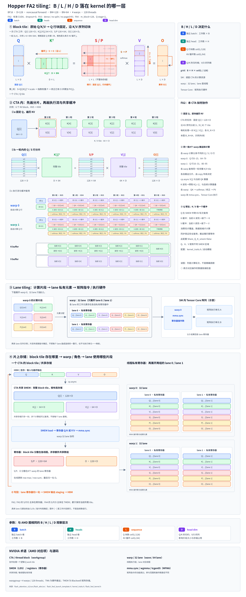

# Hopper FA2 tiling（mma.sync / cp.async 路径）

## 一句话目的

展示标准 FA2 CUDA 实现在 Hopper 上的分块：B_M、B_N、warp 布局，以及 Q / K / V 的存储和搬运顺序。

## 核心知识点

- 这是传统的 `mma.sync` / `cp.async` 路径，不是 FA3 的 Hopper 专用实现。
- 配置：BF16，D = 128，noncausal，dropout = 0；B_M = 128，B_N = 64，4 warps（128 线程）；Q 不放在寄存器（Is_Q_in_regs = false），Q 与 K 不共享 SMEM。
- 示例 L = 6 × 64 = 384，所以 Q 有 3 个 128 行块。一个 CTA 处理一个固定的 Q 块。
- Q 行分片是交错的 16 行段：w0 处理 0–15 与 64–79，w1 处理 16–31 与 80–95，w2 处理 32–47 与 96–111，w3 处理 48–63 与 112–127。
- Q 先放入 SMEM，整块 Q 不会长期留在寄存器中。`mma.sync` 的操作数经线程寄存器提供；S / P / O 和在线统计量分散在线程寄存器中。
- K 和 V 各有一个物理缓冲。K 要等 QK 读完才能覆盖，V 要等 PV 读完才能覆盖。
- 执行顺序：cp.async 加载 V[j] 与当前 QK 重叠；K[j] 被 QK 读完后，可以预取 K[j−1]，与后续 softmax 和 PV 重叠。
- 输出时在线归一化 O：线程寄存器 → SMEM 输出 staging → HBM。

## 注意

- 图只画出 warp 0 / 1 的详细执行和两个示例 lane，w2 / w3 按相同机制处理各自的 Q 行。
- 配置来自源码 `flash_fwd_launch_template.h`、`kernel_traits.h`、`flash_fwd_kernel.h`，详见来源。

## 来源

- [完整上下文（SVG、生成器与 renderer）](../../sources/hopper-fa2-tiling-context.md)
