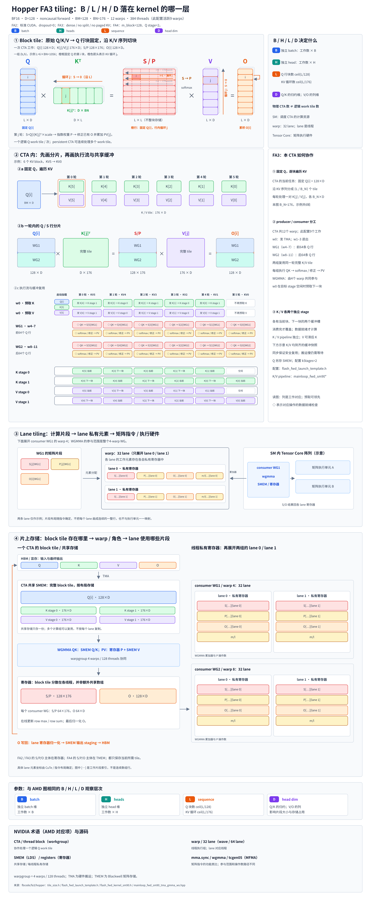

# Hopper FA3 tiling（warpgroup 与 WGMMA 路径）

## 一句话目的

展示 FA3 在 Hopper 上的分块：producer / consumer warpgroup 的分工，Q、K、V 的 SMEM 存储，以及 WGMMA 的 SS / RS 两种用法。

## 核心知识点

- 配置：BF16，D = 128，dense，noncausal；B_M = 128，B_N = 176，kStages = 2，Mma1_is_RS = true，IntraWGOverlap = true。
- 示例 L = 6 × 176 = 1056，Q 有 9 个 128 行块，最后一块只有 32 行。Q 块数不同是因为示例的 L 不同，不代表 FA3 必须处理更多 query。
- 12 个分配的 warp（384 线程）。这个配置中 producer（w0）活跃，w1–3 退出；WG1 为 w4–7，WG2 为 w8–11。
- WG1 处理 Q / S / O 的前 64 行，WG2 处理后 64 行，两者复用完整的 K[j] 和 V[j]。
- **每个 WG 自己执行 QK、softmax、O 修正和 PV**，WG1 不会把 softmax 交给 WG2，也没有 FA4 那种专职 softmax 角色。
- Q 常驻 SMEM。QK 使用 SS WGMMA（Q 和 K 都来自 SMEM）；PV 使用 RS WGMMA（P 在线程寄存器，V 在 SMEM）。
- K 和 V 各有两个独立的 SMEM stage，各自 acquire / commit / wait / release；K 和 V 的 phase 可以不同，V 可能滞后于 K。
- 最后由寄存器归一化 O，经 SMEM 输出 staging 写回 HBM。

## 注意

- 所选的 static persistent scheduler 允许一个物理 CTA 依次处理多个逻辑 Q 任务，“固定 Q”指当前领取的任务。
- 9 个工作 warp 是这个配置的情况，不是所有 FA3 都如此。

## 来源

- [完整上下文（SVG、生成器与 renderer）](../../sources/hopper-fa3-tiling-context.md)
