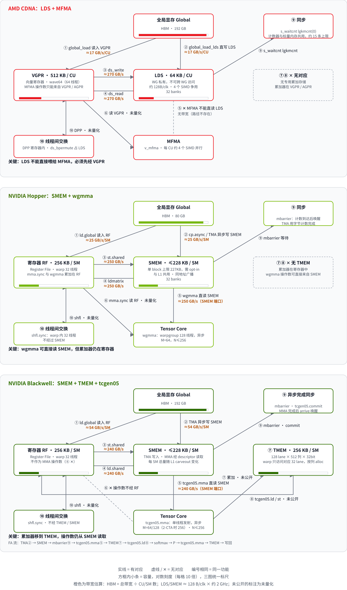

# AMD / Hopper / Blackwell 片上存储访问对照

## 一句话目的

对比三种架构的片上存储与计算单元之间的数据通路：AMD CDNA（LDS + MFMA）、Hopper（SMEM + wgmma / mma.sync）、Blackwell（SMEM + TMEM + tcgen05）。

## 核心知识点

- **计算单元能否直接读片上存储**：AMD 的 MFMA 不能直接读 LDS，必须先经 VGPR；Hopper 的 wgmma 直接读 SMEM；Blackwell 的 tcgen05.mma 直接读 SMEM。
- **累加器放在哪里**：AMD 和 Hopper 在寄存器中；Blackwell 在 TMEM，需要 tcgen05.ld / st 搬运。
- **异步完成如何同步**：AMD 用 `s_waitcnt lgkmcnt` 计数；Hopper 用 mbarrier；Blackwell 用 mbarrier 加 tcgen05.commit。
- **线程间交换**：AMD 的 DPP 在寄存器内完成，ds_bpermute 占用 LDS 带宽；NVIDIA 的 shfl.sync 不经过共享存储。
- **为什么要先搬进片上存储**：片上带宽远高于每个计算单元分到的显存份额（HBM 约 17–54 GB/s，LDS / SMEM 约 250 GB/s），数据进入片上后可以被多次复用。
- **容量差距**：片上是 KB 级，显存是 GB 级，相差约 10⁵ 倍，因此需要分块（tiling）。

## 注意

- 带宽是峰值理论估算，未经实测；B200 的 SM 数（约 148）和时钟是估算值。
- TMEM 的带宽没有可靠的公开数值，图中标为“未公开”。

## 来源

- [完整上下文（SVG 源码与渲染脚本）](../../sources/arch-datapath-context.md)
