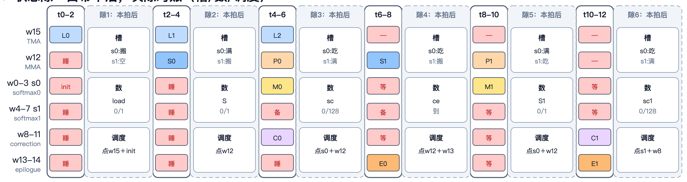

# mbarrier

mbarrier 是 SMEM 里的 8 字节计数器，用来同步异步完成的操作。它只记数，不记是谁到达的。

## 基本机制

- **init**：写入 expected 人数（cap）。在 FA4 的实现里，warp 1–7 分头初始化。
- **arrive**：计数加一。
- **try_wait**：睡到计数够了为止；放行时翻转 phase，计数清零，进入下一轮。
- **死锁的唯一来源**：expected 人数写错，一方永远等不够数。

## 在 FA4（Blackwell）里的用法

- **full**：表示槽位已经装满，可以被消费。
- **empty**：表示槽位已经用完，可以被再次搬入。
- 所有被覆写的数据（TMEM 中的 S / P，SMEM 中的 O 槽）都配一对 full / empty。

FA4 的 warp 分工：w15 做 TMA 搬运，w12 做 MMA，w0–7 做 softmax（分成 s0、s1 两拨），w8–11 做 correction，w13–14 做 epilogue。两拨 softmax 执行顺序不同，分两批被唤醒。

图中的 cycle 带不是等长周期，也不是精确的时钟 trace：白色格子表示干活，红色块表示睡眠，红色竖线表示放行时刻。

## 未验证

- 图中每两拍一格的 cycle 带是示意，没有对照真实 trace 逐拍核对。

## 来源

- [mbarrier 融合图的上下文（完整 SVG 与说明）](../../sources/mbarrier_context.md)
