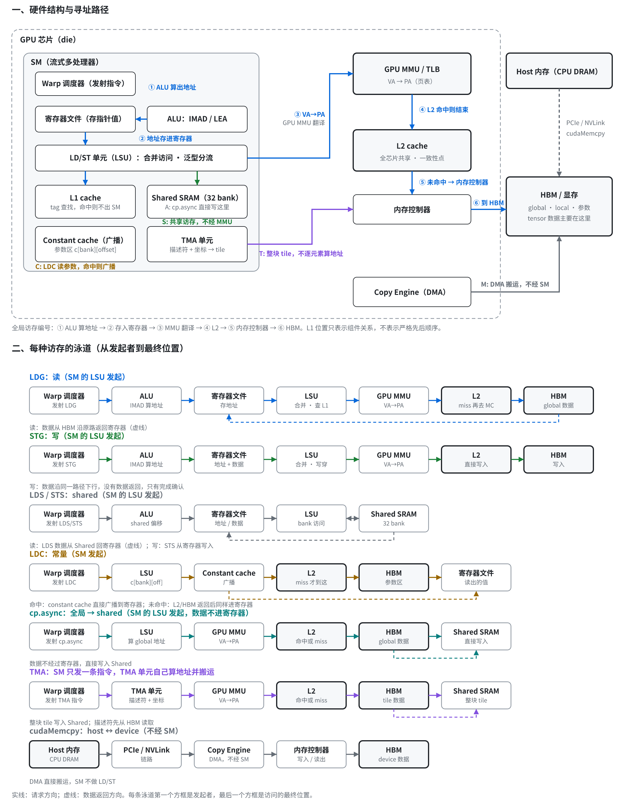

# GPU 访存路径（六类）

## 一句话目的

按硬件结构画出 GPU 的六类访存路径，并说明每类访存能被哪种工具（Compute Sanitizer 的 exact 模式、CUPTI 的 args 模式）观测到。

## 核心知识点

- **硬件结构**：SM 内有 warp 调度器、寄存器文件、ALU、LSU、L1、shared memory、constant cache、TMA；SM 外有 GPU MMU、L2、内存控制器、HBM、Copy Engine、Host 内存和对端 GPU。
- **六类路径**：① 直接 LD/ST（warp → LSU → L1 → L2 → HBM）；② cp.async（数据直接写入 shared，不经寄存器）；③ 拷贝与填充（Host → PCIe → Copy Engine → HBM，不经 SM）；④ 参数中的指针（通过 constant bank 读取，是指针值而非数据访问）；⑤ CUDA graph（GPU 前端按节点调度）；⑥ TMA 与 NVLink（TMA 写整块 tile 到 shared）。
- **Hook 点**：H1 allocator（块的生命周期，CPU 侧）；H2 CUPTI launch（读取参数指针）；H3 CUPTI API（memcpy / memset 指针）；H4 Sanitizer 插桩（挂在 LSU 上，唯一能拿到读写类型和虚拟地址的位置）；H5 TMA（CUPTI 只能看到 CUtensorMap 基地址）；H6 CUDA graph（capture 期间没有可用 hook）。
- **A100 上的结果**：exact 模式在 15 个可运行场景中全部正确，CUDA graph 因 Sanitizer 在 capture 时崩溃而无法运行。args 模式在 16 个场景中有 11 个正确，问题是分不清读写、漏掉间接访问和 cuMemsetD8，并把只传参数的指针误报为访问。
- **代价**：exact 模式约 78 秒 / 迭代，慢约 100 倍，每张卡多约 6 GB 显存。

## 未验证

- TMA 和 NVLink 只在 A100 上测过（未测）；需要 H100 / B200 或多卡环境。
- 真实负载只在 torchrec `--world_size 1` 下跑过；fsdp-adam 没跑过 exact 模式。
- 图中的地址（如 0x00007f3a40001414）是示意值，不是真实 trace。

## 来源

- [完整上下文（含绘图脚本与 renderer）](../../sources/memory-access-paths-context.md)
