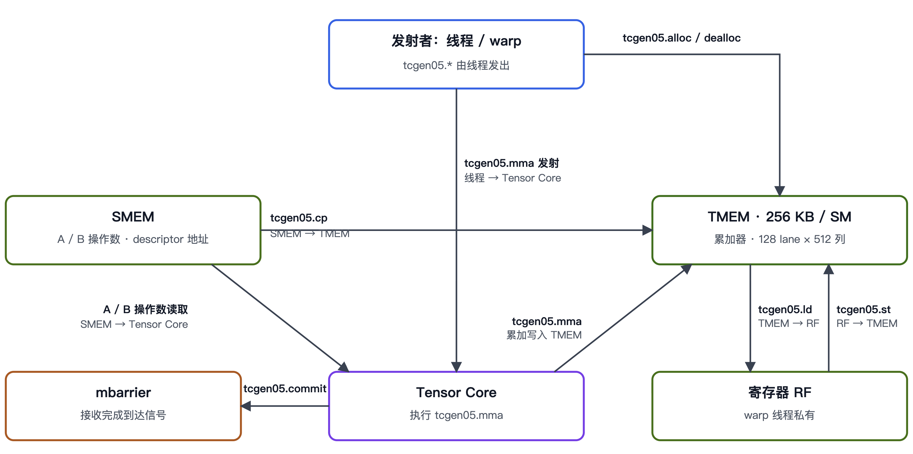

# tcgen05 stream ops

## 一句话目的

主要介绍 tcgen05 操作在各个层级 memory 之间的关系：SMEM、TMEM、寄存器与 Tensor Core。

## 核心知识点

- **MMA**：Matrix Multiply-Accumulate，矩阵乘加。
- **tcgen05.mma**：TensorCore 5th Generation MMA，第五代 Tensor Core 的矩阵乘加指令（Blackwell）。由线程（warp）发出，Tensor Core 异步执行。
- **数据流**：A / B 操作数从 SMEM 直接读取到 Tensor Core（由 descriptor 给出地址），不经寄存器；累加结果写入 TMEM。
- **TMEM**：256 KB / SM，128 lane × 512 列。`tcgen05.alloc` / `dealloc` 管理分配。
- **搬运指令**：`tcgen05.cp` 把 SMEM 拷到 TMEM；`tcgen05.ld` 把 TMEM 读到寄存器（RF）；`tcgen05.st` 把寄存器写回 TMEM。
- **完成通知**：`tcgen05.commit` 把 MMA 的完成信号送到 mbarrier。

## 来源

- 图为 Blackwell 数据流的手绘示意，没有对应的 paste 上下文。
