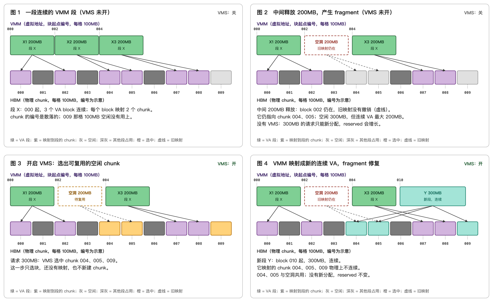
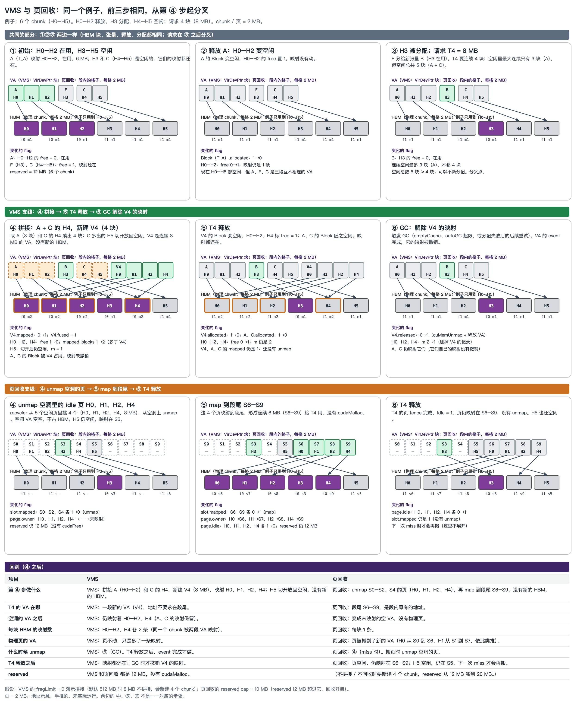

# VMM 与 expandable_segments

## 一句话目的

从 kernel 的角度端到端展示 VMM 的流程，说明 VMM 是 expandable_segments 段尾扩展的关键。

## 核心知识点（用户原话，已润色）

VMM 把虚拟地址和物理 chunk 解耦：先预留一段连续 VA，再逐个映射 chunk，在预留范围内保证虚拟地址段连续。expand 只在段尾映射新 chunk，地址接着往后走，因此段保持连续，物理 chunk 不需要连续。

## VMS：修复 fragment

### 一句话目的

用实际例子解释 VMS 是怎么解决 fragment 的。

### 论文

- 标题：GMLake: Efficient and Transparent GPU Memory Defragmentation for Large-scale DNN Training with Virtual Memory Stitching
- 会议：ASPLOS 2024
- arXiv：[2401.08156](https://arxiv.org/abs/2401.08156)
- 作者：待补充（未能从外部获取，需要核对）

### 核心知识点（已润色）

用一个实际在 VA 上产生 fragment 的例子：VMS 把 fragment 区域（空洞）对应的 chunk 重新映射到段尾新的连续 VA 上，让这些 chunk 被使用，从而变相解决了"fragment 区域占着 chunk"的问题。VA 内部的 fragment 仍然存在，但 VA 可以比 HBM 大（预留 VA 不占显存，只有映射上的 chunk 占显存），这些 fragment 本质上不影响 HBM 的利用率。

fragment 的根源是"连续 VA 的要求"和"物理 chunk 不连续"之间的矛盾；VMS 不挪动已有的 chunk，而是再用 VMM 映射一次，绕开这个矛盾。

## VMS 与页回收：同一个例子的对比

### 一句话目的

用同一个例子（6 个 chunk，请求 4 块）比较 VMS 拼接和页回收两种减小 fragment 的方式。

### 核心知识点（草稿，待确认）

两种方法的根本区别在**回收的动作**。VMS 的回收是 GC：不在释放 tensor 时做，而是等触发条件（VA 分配失败、autoGC 超限、分配失败后的重试、emptyCache）之一满足，并且 cudaEvent 完成之后，才删掉旧 VA 的反向引用，再 cuMemUnmap；PhyBlock 保留，reserved 不降。页回收的回收是搬页：miss 时同步 unmap 空洞里的 idle 页，再 map 到段尾；每个页任何时刻只有一段 VA；回收发生在分配路径上，reserved 也不降。要分清这两种回收，需要熟悉 GC 的每一步和每个触发点，因为 VMS 的旧映射什么时候消失，完全由 GC 决定。

## 来源

- [VMM 与 expandable_segments：v5（当前版本）](../../sources/vmm-expandable-segments-v5.md)
- 历史版本：[v4](../../sources/vmm-expandable-segments-v4.md)、[v3](../../sources/vmm-expandable-segments-v3.md)、[v2](../../sources/vmm-expandable-segments-v2.md)、[v1](../../sources/vmm-expandable-segments-v1.md)
- [VMS 修复 fragment：2×2 示意图（完整 SVG）](../../sources/vms-fragment-repair.md)
- [VMS 与页回收对比（完整 SVG）](../../sources/vma-compare-vms-page-recycle.md)
- 被取代的旧版本（VMS 与 doc 搬页对比）：[vma-compare-vms-doc-superseded](../../sources/vma-compare-vms-doc-superseded.md)
