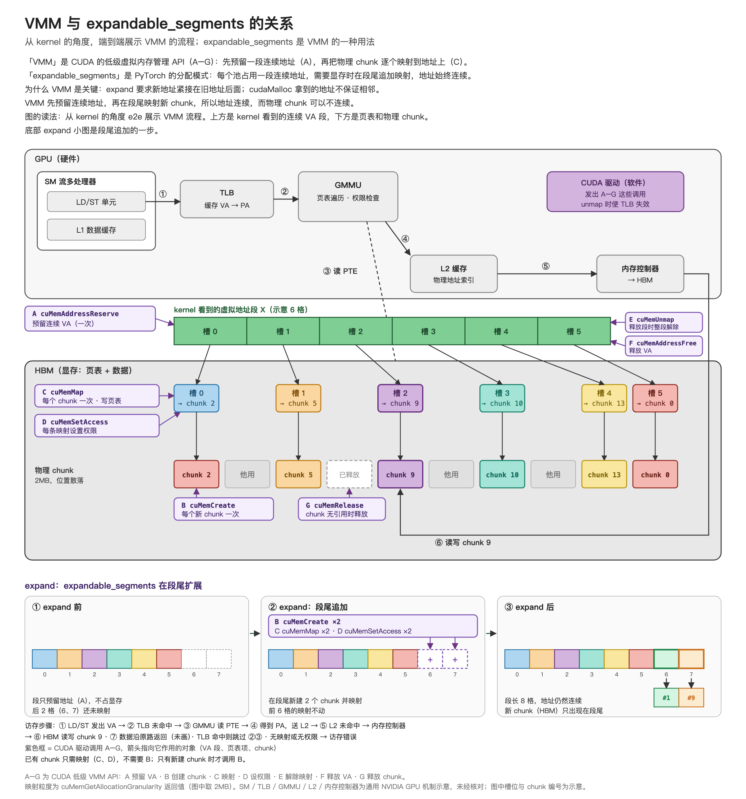

# VMM 与 expandable_segments

## 一句话目的

从 kernel 的角度端到端展示 VMM 的流程，说明 VMM 是 expandable_segments 段尾扩展的关键。

## 核心知识点（用户原话，已润色）

VMM 把虚拟地址和物理 chunk 解耦：先预留一段连续 VA，再逐个映射 chunk，在预留范围内保证虚拟地址段连续。expand 只在段尾映射新 chunk，地址接着往后走，因此段保持连续，物理 chunk 不需要连续。

## 来源

- [v5（当前版本）](../../sources/vmm-expandable-segments-v5.md)
- 历史版本：[v4](../../sources/vmm-expandable-segments-v4.md)、[v3](../../sources/vmm-expandable-segments-v3.md)、[v2](../../sources/vmm-expandable-segments-v2.md)、[v1](../../sources/vmm-expandable-segments-v1.md)
