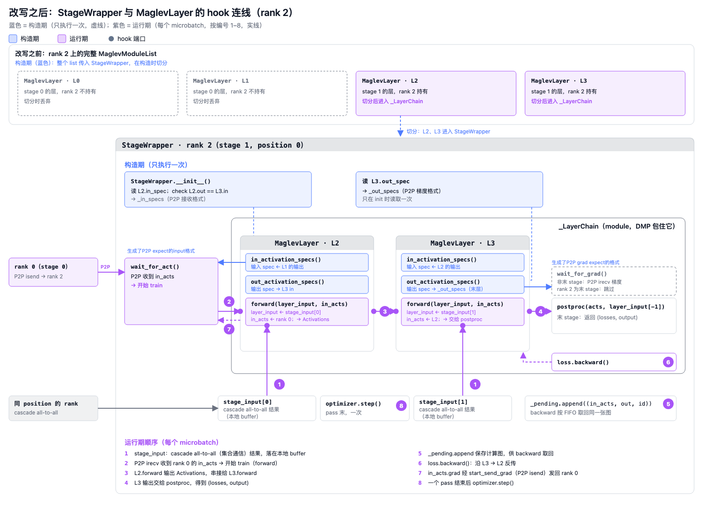

# Maglev StageWrapper 的 hook 连线（rank 2）

## 一句话目的

说明 rank 2 上的 StageWrapper 怎样通过 hook 与 MaglevLayer 连接：改写之前的完整 MaglevModuleList，构造期读取 spec 并切分，运行期按 1–8 的顺序执行。

## 核心知识点（由已核对的知识条目归纳）

- **每个 rank 都传入整个 model。** StageWrapper 保留连续的一段层，丢掉其余；保留的是 model 自己的 module，不是拷贝。
- **activation specs 只在构造时读一次。** `__init__` 用第一层的 `in_activation_specs()` 生成 `_in_specs`（P2P 接收格式），用最后一层的 `out_activation_specs()` 生成 `_out_specs`（P2P 梯度格式）。这发生在任何 wrap 之前。
- **postproc 只挂在末 stage 上。** 末 stage 的 `_LayerChain` 才有 postproc；`start_recv_grad` 在末 stage 直接返回，不接收梯度。
- **梯度过滤靠 `_out_specs`。** 反向时只对 `requires_grad` 的输出分配 buffer、过滤 grad-carrying 输出。
- **`_LayerChain` 的存在是为了 DMP。** `DistributedModelParallel` 只能包一个 module，所以 stage 的层要放进一个容器。
- **运行期顺序。** `stage_input` 来自 cascade 上的 all-to-all（集合通信），落在本地 buffer；`wait_for_act` 是从 rank 0 的 P2P irecv；forward 串接各层；`_pending` 按 FIFO 保存计算图；loss.backward 沿层反传；in_acts.grad 经 P2P isend 发回 rank 0；pass 结束后 optimizer.step 一次。

## 未验证

- `rewrite_into_stage_bundles` 内部是否只保留本 stage 的 bundle，没有读实现。
- APS 上整模型是否在 meta 上构造，代码里没有找到 meta 相关逻辑，图里不写 meta。
- APS 侧的 bundle rewrite 没有画进图的顶部区域。

## 来源

- [完整 paste（SVG 源码、知识表与修改记录）](../../sources/maglev-stagewrapper-hooks.md)
