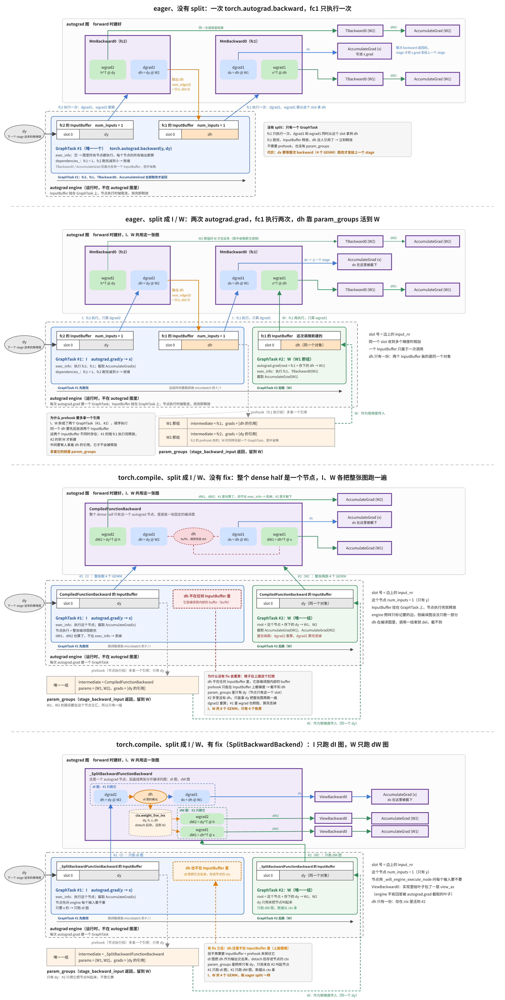

# Zero-bubble 的 backward 拆分（dI / dW）

## 一句话目的

这张图解释 PP 的 split dI / dW 是怎么做的。

## 核心知识点（用户原意，已润色）

之前的实现只能在 eager 模式下工作。原因是：拆分 I / W 的结果，是一个 microbatch 的 backward 变成两个 GraphTask（#1 I、#2 W，顺序执行），而这两个 GraphTask 都需要中间梯度 dh。之前的实现借 engine 的 InputBuffer 拿到 dh：dh 进入 fc1 的 InputBuffer 时被 prehook 截下，引用存进 param_groups，W 再把它喂回一个新的 InputBuffer。

compile 模式下，按 op 划分的多个 autograd 节点（fc1、fc2 的 `MmBackward0` 和 `TBackward0`）被合成一个 `CompiledFunctionBackward` 节点，dh 不再是节点之间的中间变量，也就不会存进 InputBuffer。prehook 截不到 dh，W 只能触发重算。

解法是让拆出来的 dI 图把 dh 作为输出交出来，存进节点的 ctx，由 ctx 把 dh 传给 W。

## 来源

- [完整上下文（SVG 源码与说明）](../../sources/backward_split_context.md)
- [GB200 实测数据（单 GPU，batch 16384，dim 4096，fp32）](../../sources/backward_split_measurements.md)
